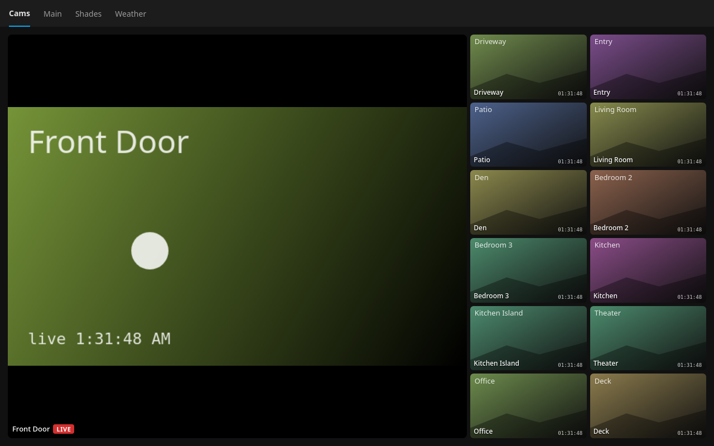
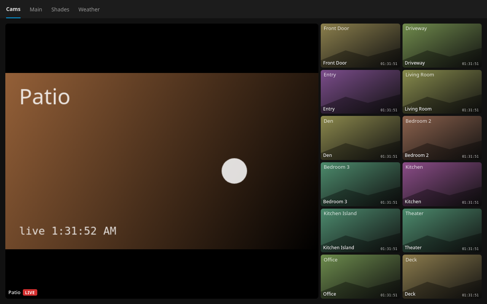
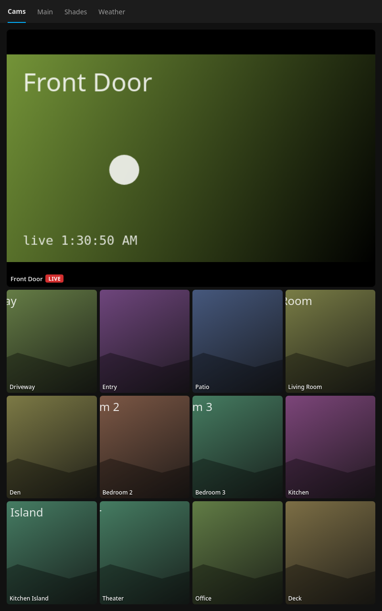

# Easy Camera Grid Card (Ltek)

[](https://my.home-assistant.io/redirect/hacs_repository/?owner=Ltek&repository=easy-camera-grid-card&category=plugin)

A Home Assistant Dashboard card for wall panels and tablets: one large **live** camera, and every other
camera as a **snapshot** tile that refreshes every few seconds. Tap a tile and that camera becomes the
live one. History is in [CHANGELOG.md](CHANGELOG.md).



## Why

A grid of 13 live streams makes a tablet decode 13 videos at once. This card plays **one** stream (the large
pane) and shows the rest as JPEG snapshots, asked for at the size each tile is drawn. Nothing streams or
refreshes while the card or the page is hidden.

## Features

- **Large live pane** using Home Assistant's own camera player (WebRTC, HLS or MJPEG, whatever the camera offers).
- **Snapshot grid** of all the other cameras, refreshed every 2 seconds by default.
- **Tap to promote:** the tapped camera goes live; the previous one returns to its place in the grid.
- **Landscape and portrait in one card.** Landscape puts the pane left or right, portrait on top or bottom.
  Each has its own pane size, columns and rows. The card follows the screen when the tablet is turned.
- **Per camera or all the same:** snapshot or live tile, refresh interval and fit, each with a card-wide default.
- **Start camera and grid order** are yours to set.
- **Go back** to the start camera after a time without touches (optional).
- **Fits the screen:** `height: fill` sizes the card to the rest of the screen; or give any CSS height.
- A visual editor for every setting.

| Tapped a tile | Portrait |
|---|---|
|  |  |

Screenshots use made-up cameras.

## Install

1. Click **Add to HACS** above (or add `https://github.com/Ltek/easy-camera-grid-card` as a custom
   repository, type **Dashboard**), then **Download**.
2. Reload the browser.
3. Add the card **Easy Camera Grid Card (Ltek)** to a dashboard. For a wall panel, put it alone in a
   **Panel** view.

## Configuration

```yaml
type: custom:easy-camera-grid-card
main_camera: camera.front_door     # starts in the large pane (default: the first camera)
cameras:                           # the grid uses this order
  - camera.front_door
  - camera.driveway
  - entity: camera.patio
    name: Back patio
  - entity: camera.garage
    tile_mode: live                # this tile streams instead of snapshots
  - entity: camera.yard
    refresh_seconds: 10            # this snapshot reloads every 10 s
refresh_seconds: 2
reset_after: 120                   # back to main_camera after 2 minutes without a touch
landscape:
  main_position: left
  main_size: 66
  columns: 2
portrait:
  main_position: top
  main_size: 45
  columns: 4
```

| Option | Default | What it does |
|---|---|---|
| `cameras` | (required) | Camera entities, as `camera.x` or `{ entity, name, tile_mode, refresh_seconds, fit }`. The grid uses this order. |
| `main_camera` | first camera | The camera in the large pane when the card starts. |
| `tile_mode` | `snapshot` | Default tile: `snapshot` (JPEG) or `live` (stream). |
| `refresh_seconds` | `2` | Default snapshot refresh, in seconds (0.5 or more). |
| `tile_fit` | `cover` | `cover` fills the tile (crops), `contain` shows the whole picture, `fill` stretches. |
| `show_names` | `true` | Camera name on each tile. |
| `main_fit` | `contain` | Fit of the large pane. |
| `muted` | `true` | Large pane audio off. |
| `show_main_name` | `true` | Name and LIVE badge on the large pane. |
| `reset_after` | `0` | Seconds without a touch before going back to `main_camera`. `0` turns it off. |
| `orientation` | `auto` | `auto` follows the screen; `landscape` or `portrait` fixes it. |
| `height` | `fill` | `fill` = rest of the screen, or a CSS height (`600px`, `70vh`). |
| `gap` | `6` | Space between pane and tiles, in px. |
| `landscape` / `portrait` | see below | `main_position` (`left`/`right`, `top`/`bottom`), `main_size` (% of the card), `columns`, `rows` (`0` = as many as needed). |

Layout defaults: landscape `left`, `60`%, 3 columns; portrait `top`, `45`%, 3 columns; rows `0`.

### Fitting a 16:10 tablet

Tiles fill their part of the card, so their shape comes from the columns and rows. For 12 tiles in
landscape, `columns: 2` with `main_size: 66` gives tiles close to 16:9, so `cover` crops very little.

## Good to know

- Snapshots come from Home Assistant's `/api/camera_proxy`, at the size the tile is drawn. Each tile waits
  for its picture before asking for the next one, so a slow camera never piles up requests.
- The large pane needs a camera that Home Assistant can stream. If it can't, the pane keeps showing the
  last snapshot.
